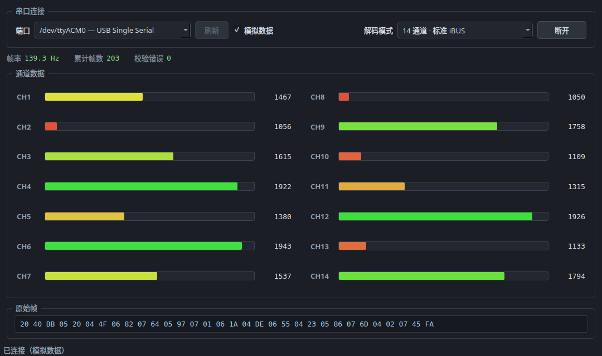

# FS-IBUS 接收机监视器

用 PyQt5 编写的 FlySky iBUS 接收机数据监视器：从串口读取 32 字节 iBUS 帧，
实时显示各通道数值，并校验帧完整性。



> 上图为「模拟数据」模式下的界面预览（默认 14 通道解码）。

支持两种解码模式：

| 模式 | 说明 | 通道 | 量程 |
| --- | --- | --- | --- |
| **14 通道 · 标准 iBUS**（默认） | 通用 FlySky iBUS，每通道 16bit 小端 | CH1–CH14 | 1000–2000 |
| 18 通道 · 12bit 紧凑格式 | 本机接收机协议，通道高位/扩展通道共享半字节 | CH1–CH18 | 0–4095 |

## 功能

- 串口选择 / 刷新 / 连接，读取线程独立于界面，不卡顿
- 18 条通道进度条 + 数值，按值高低由红到绿渐变
- 实时统计：帧率（约 143 Hz）、累计帧数、校验错误数
- 原始帧十六进制显示，便于对照协议排查
- 「模拟数据」模式：无硬件时生成正弦变化的帧，可直接预览界面
- 校验失败自动丢掉坏帧并重新同步帧头

## 环境要求

- Python 3.8+
- PyQt5、pyserial

```bash
pip3 install pyqt5 pyserial
```

Linux 下读取串口需要权限，把当前用户加入 `dialout` 组后**重新登录**：

```bash
sudo usermod -aG dialout $USER
```

## 运行

```bash
cd ~/FS-IBUS
python3 ibus_gui.py
```

连接步骤：

1. 在「端口」下拉框选择接收机对应的串口（如 `/dev/ttyACM0`、`/dev/ttyUSB0`），
   插拔设备后点「刷新」
2. 选择「解码模式」（默认 14 通道）
3. 点「连接」，通道条开始刷新

没有硬件时勾选「模拟数据」再点「连接」即可查看演示效果。

## 协议说明

帧固定 32 字节，以 `0x20 0x40` 开头，波特率 115200，约 143 帧/秒。

### 校验

```
Checksum = (Byte1 + Byte2 + ... + Byte30) ^ 0xFFFF
```

Byte31 为校验低 8 位，Byte32 为高 8 位（小端）。

### 18 通道紧凑格式

每通道 12bit（0–4095）。CH1–CH12 的低 8 位占一个字节，高 4 位放在下一字节的
高半字节；扩展通道 CH15–CH18 的 3 个 4bit 分段放在这些字节的低半字节里。

| 字节 | 内容 |
| --- | --- |
| 1 | `0x20` |
| 2 | `0x40` |
| 3 | CH1[0-7] |
| 4 | CH15[0-3] · CH1[8-11] |
| 5 | CH2[0-7] |
| 6 | CH15[4-7] · CH2[8-11] |
| 7 | CH3[0-7] |
| 8 | CH15[8-11] · CH3[8-11] |
| 9 | CH4[0-7] |
| 10 | CH16[0-3] · CH4[8-11] |
| 11 | CH5[0-7] |
| 12 | CH16[4-7] · CH5[8-11] |
| 13 | CH6[0-7] |
| 14 | CH16[8-11] · CH6[8-11] |
| 15 | CH7[0-7] |
| 16 | CH17[0-3] · CH7[8-11] |
| 17 | CH8[0-7] |
| 18 | CH17[4-7] · CH8[8-11] |
| 19 | CH9[0-7] |
| 20 | CH17[8-11] · CH9[8-11] |
| 21 | CH10[0-7] |
| 22 | CH18[0-3] · CH10[8-11] |
| 23 | CH11[0-7] |
| 24 | CH18[4-7] · CH11[8-11] |
| 25 | CH12[0-7] |
| 26 | CH18[8-11] · CH12[8-11] |
| 27 | CH13[0-7] |
| 28 | CH13[8-11] |
| 29 | CH14[0-7] |
| 30 | CH14[8-11] |
| 31 | Checksum[0-7] |
| 32 | Checksum[8-15] |

解码公式：

```
CHn   = Byte(2n+1) | ((Byte(2n+2) >> 4) << 8)        n = 1..12
CH13  = Byte27 | ((Byte28 >> 4) << 8)
CH14  = Byte29 | ((Byte30 >> 4) << 8)
CH15  = (Byte4  & 0xF) | ((Byte6  & 0xF) << 4) | ((Byte8  & 0xF) << 8)
CH16  = (Byte10 & 0xF) | ((Byte12 & 0xF) << 4) | ((Byte14 & 0xF) << 8)
CH17  = (Byte16 & 0xF) | ((Byte18 & 0xF) << 4) | ((Byte20 & 0xF) << 8)
CH18  = (Byte22 & 0xF) | ((Byte24 & 0xF) << 4) | ((Byte26 & 0xF) << 8)
```

### 14 通道标准格式

每个通道占 2 字节（Byte3 起），低字节在前：

```
CHn = Byte(2n+1) | (Byte(2n+2) << 8)                 n = 1..14
```

## 常见问题

**1. 启动时报 `undefined symbol: __libc_pthread_init`**

从 VSCode（snap 版）的集成终端启动时，终端会注入指向 `/snap/` 的 GTK 环境变量，
系统 Qt 误加载 snap 内的 glibc 组件导致崩溃。程序启动时会自动清理这些变量；
如仍遇到，可改用系统终端运行，或：

```bash
env -u GTK_PATH -u GTK_EXE_PREFIX python3 ibus_gui.py
```

**2. 连接时提示「无权限打开 `/dev/ttyACM0`」**

按上文执行 `sudo usermod -aG dialout $USER`，并重新登录（或重启会话）。

**3. CH13 / CH14 数值异常**

协议表未注明 Byte28 / Byte30 中高 4 位所在半字节，程序按高半字节解码。
若实际数据不符，把 `decode_channels()` 中对应两行的 `>> 4` 改为 `& 0x0F`。

**4. 通道条只走到中间**

18 通道模式进度条量程是 0–4095。若接受机实际输出 1000–2000 的映射值，
改用 14 通道模式显示，或按需调整 `_apply_mode()` 中的量程。

## 文件结构

```
ibus_gui.py      # 全部代码：协议解析、串口线程、界面
screenshot.png   # 界面截图（README 引用）
README.md
```

主要组成：

- `decode_channels()` — 按模式把 32 字节帧解析成通道值
- `IBusParser` — 帧头同步、校验、坏帧重同步
- `SerialWorker` / `SimWorker` — 串口读取线程 / 模拟数据线程
- `ChannelWidget` — 单通道进度条组件
- `MainWindow` — 界面与连接管理
